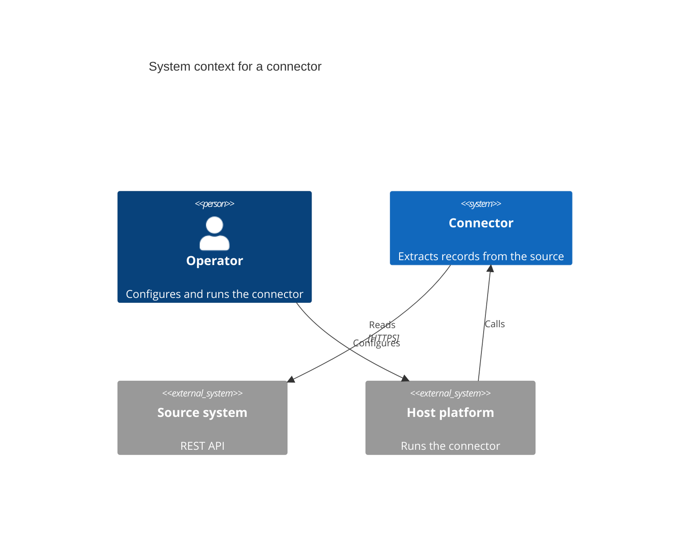
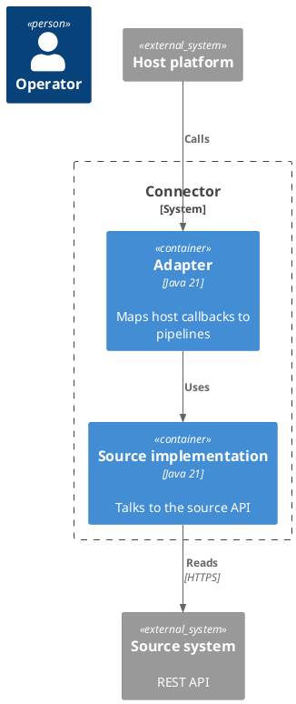
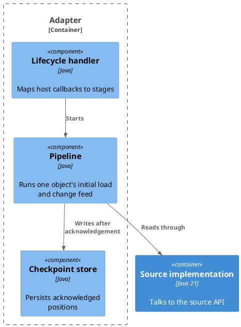
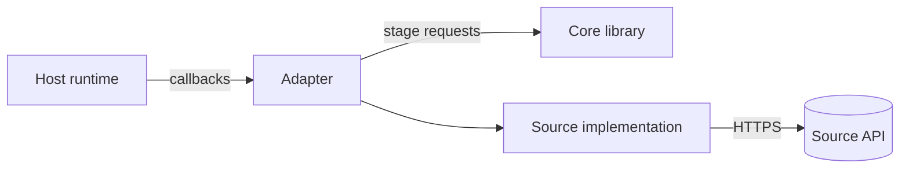

# C4 diagrams

**Target:** $ARGUMENTS

Draw the system as it exists, top-down and only as deep as adds value. If no target is given, use the repository in the current directory.

## 1. Preflight

1. **Ground it in reality.** Read the build files (`settings.gradle(.kts)`, module build files, `pom.xml`), the main entry points, the configuration and the README. Record the containers, components, datastores and external systems that actually exist, and the protocols between them. Never draw an aspirational architecture as if it existed; mark planned parts as planned.
2. **Find existing diagrams** in `docs/architecture/`, `docs/diagrams/` or the README. Update them rather than creating a parallel set, and keep their format (PlantUML or Mermaid).
3. **Keep it proportionate.** A small library needs a context diagram at most.
4. **Check the tooling.** Mermaid renders in GitHub, GitLab and most Markdown viewers, but its C4 support is experimental. PlantUML needs Java, and Graphviz (`dot`) for most diagram types. Don't claim a diagram rendered unless you rendered or parsed it.

## 2. Levels

- **L1 System context:** the system, its users, and its neighbouring systems.
- **L2 Container:** apps, services, jars and datastores, and how they talk. Usually the most useful level.
- **L3 Component:** the major components inside the most important container.
- **L4 Code:** only when it adds value; suggest the `class-diagram` command for it.

In a connector, the usual picture is: the host platform calls the connector's adapter, which uses the source implementation, which calls the source system's API. The usual containers are the core library, the source-implementation jar, the adapter jar, and the state each keeps on disk (working directories, checkpoint stores). Name the real host, adapter, source and protocols.

## 3. Templates

Every template below was checked: the Mermaid one parses with Mermaid 11, and the PlantUML ones pass `plantuml -checkonly`. Replace the example names with real ones.

**L1 context (Mermaid)**

**L2 container (PlantUML).** The `<C4/...>` include uses the C4 library bundled with PlantUML, so it needs no network.

**L3 component (PlantUML)**

**Fallback when Mermaid C4 doesn't render where it will be read (Mermaid flowchart)**

## 4. Save and check

- Save the diagrams where the repo keeps architecture docs, or under `docs/architecture/` if there's no such place: one file per level, `.puml` for PlantUML, `.md` or `.mmd` for Mermaid.
- Parse or render each one: `plantuml -checkonly file.puml`, then `plantuml -tsvg file.puml`; for Mermaid, `mmdc -i file.mmd -o file.svg` if mermaid-cli is installed, or a Markdown preview. If no tool is available, say the diagrams are unrendered.
- Check that every container and relationship in the diagram exists in the code or build, and that none is missing.

## Avoid these errors

- `!include <C4/C4_Container>` works with PlantUML's bundled library. URL includes (`!includeurl`, raw GitHub links) need network access.
- Mermaid's C4 support is experimental. Keep to the elements in the template, check it renders where it will be read, and fall back to the flowchart if it doesn't.
- In Mermaid, quote labels that contain brackets or parentheses, and never use `end` as a bare node name.
- Real names only. Every container and component exists in the code or build, or is marked as planned.
