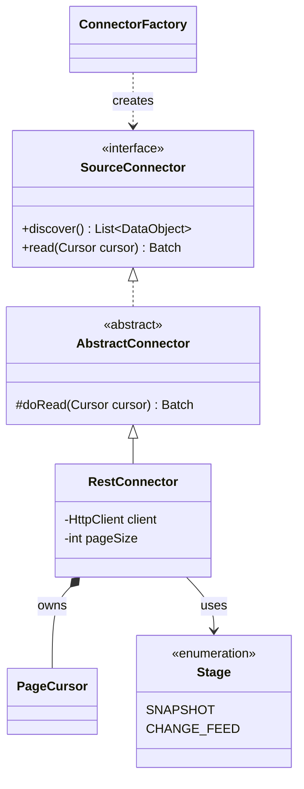
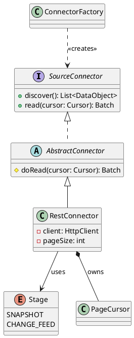

# Class diagram

**Scope:** $ARGUMENTS

Draw the types in scope and how they relate, extracted from the source. If no scope is given, list the module's packages with their type counts and ask which one to draw.

## 1. Extract every type in scope

1. **Find the scope.** If the package, module or class can't be found, say so and list near matches.
2. **Check it's readable.** At 20 or more types, propose one diagram per package or concern instead, plus a small overview showing only the main types.
3. **For each type, record:**
   - its kind: interface, abstract class, class, enum or record;
   - its key members: public and protected methods, and the fields that carry relationships (all members on request);
   - its relationships, using the mapping below.
4. **Count the types and edges** so you can check the diagram against them at the end.

Map Java to UML edges like this. The arrow syntax is the same in Mermaid and PlantUML:
- `class B extends A` is generalization: `A <|-- B`
- `class B implements A` is realization: `A <|.. B`
- a field whose lifecycle `A` controls (it creates and closes `B`) is composition: `A *-- B`
- a field holding a shared or injected `B` is association: `A --> B`
- a parameter, a local variable, or a `new B()` that isn't kept is dependency: `A ..> B`

Label edges where the reason isn't obvious, for example `creates` or `uses`.

## 2. Draw it

Both templates were checked: the Mermaid one parses with Mermaid 11, and the PlantUML one passes `plantuml -checkonly`. Replace the example names with real ones.

**Mermaid**

**PlantUML (full members)**

## 3. Save and check

- Save both versions where the repo keeps diagrams, or under `docs/diagrams/` if there's no such place (`.mmd` or `.md` for Mermaid, `.puml` for PlantUML).
- Parse or render them: `plantuml -checkonly file.puml`, then `plantuml -tsvg file.puml`; for Mermaid, `mmdc -i file.mmd -o file.svg` if mermaid-cli is installed, or a Markdown preview. If nothing is available, say the diagram is unrendered.
- Check that the type and edge counts in the diagram match the counts from step 1.

## Avoid these errors

- **PlantUML: one member per line.** A one-line body such as `interface Foo { +bar(): int }` fails to parse. Class diagrams need Graphviz (`dot`); without it, add `!pragma layout smetana`.
- **Mermaid generics** are written `List~Row~`, not `List<Row>`.
- **Mermaid stereotypes** go inside the class body (`<<interface>>`), or on their own line.
- **Names match the code exactly,** including the case. Types outside the scope that you show for context are marked as such or kept without members.
