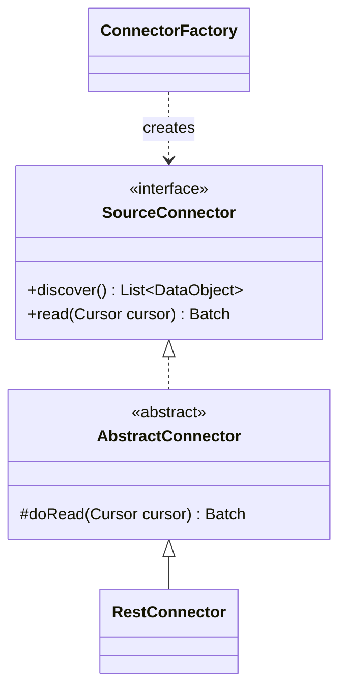
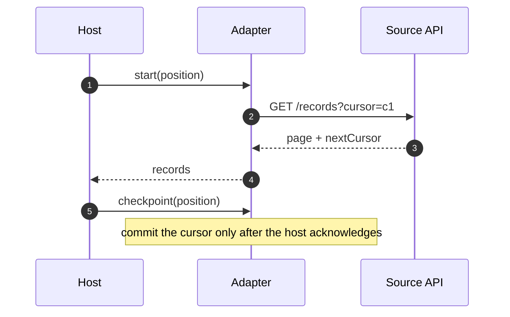

# Low-level design

**Feature:** $ARGUMENTS

Design the feature before it's coded: responsibilities, classes and interfaces, contracts, patterns, error and concurrency strategy, package layout, and diagrams. If no feature is given, ask what to design, and stop.

## 1. Preflight

1. **Check the scope is worth a document.** A single small class needs a paragraph, not a design doc. Say so, and give the proportionate output.
2. **Check there's enough input.** If the requirements or constraints are too vague, list the specific questions instead of inventing assumptions.
3. **Ground it in the real code.** Read the code and build files first, and use real type names. Never design on top of classes that don't exist. If the code contradicts the request's premise, say so before designing.
4. **Don't re-decide decided things.** Check existing design docs, ADRs, and rules in `CLAUDE.md` or `CONTRIBUTING` ("don't add X back", "no thread pools here"). Supersede a decision explicitly; never contradict it silently.

## 2. Method

1. **Clarify the problem and its boundaries:** inputs and outputs, the public API surface, invariants, and what is explicitly out of scope.
2. **Assign responsibilities.** List them, then find the smallest set of classes or interfaces that own them, each with one reason to change. Prefer composition, depend on interfaces, and keep the API narrow.
3. **Put each responsibility in the right module.** A connector platform usually has three layers, with dependencies pointing inward only:
   - **core contract:** mechanism, such as queues, checkpoints and stores;
   - **source implementation:** facts about one source, such as its API, paging and types;
   - **host adapter:** orchestration, meaning when a stage runs, whether it's done, and where it resumes.

   An implementation never depends on a sibling implementation.
4. **Apply patterns deliberately.** Name each pattern and the force it resolves; never use a pattern for its own sake. Strategy for interchangeable algorithms, Factory for construction behind a seam, Template Method for a fixed skeleton with varying steps (a `final` method calling `doXxx` hooks), Decorator for layered behaviour, Builder for many parameters, Adapter for bridging contracts, Observer for events.
5. **Do a SOLID pass:** single responsibility (cohesive classes), open/closed (extend through new types, not edits), Liskov substitution (honest subtypes), interface segregation (narrow role interfaces, such as a reader and a writer split from one queue), dependency inversion (depend on abstractions). Name any violation, and resolve it or accept it knowingly.
6. **Cover the cross-cutting concerns:** the data model and immutability; validation and the error model (exceptions carry evidence, not just a verdict); concurrency and thread-safety (who owns which thread); resource lifecycle (who closes what); and testability seams (where a fake plugs in).
7. **Lay out packages** by responsibility or feature, acyclic, with dependencies pointing inward.
8. **Draw it:** a class diagram for the structure and a sequence diagram for the main flow (templates below).

## 3. Connector design principles (apply where relevant)

- **At-least-once over at-most-once.** A record may arrive twice but must never be lost. Make loss impossible to express, not merely unlikely.
- **Lag is safe; lead is fatal.** A checkpoint behind reality costs a replay; one ahead of reality skips data. Acknowledge first, then checkpoint.
- **Refuse the ambiguous case.** When two situations look identical and one is catastrophic, fail loudly, naming the evidence.
- **Isolate per pipeline.** Give each object or stage its own queue, cursor and thread. Scale by adding pipelines, not by sharing them.
- **Make mistakes impossible to write:** `final` methods, `switch` expressions over enums (a new constant then fails to compile), narrow types.
- **Keep mechanism and policy apart.** Mechanism belongs in the core; policy belongs to the consumer.
- **One fact, one place.** Each key, ordering or name is declared once.
- **Every setting does what it says.** A config key nothing reads is a trap: delete it or wire it, and test it.
- **Prefer honest uncertainty to a confident guess.** Report "unknown" rather than a guess that looks like a fact.
- **Fail loudly and resumably.** Fail the stage, keep the last acknowledged position, and re-read from there. Retry policy belongs to the platform that embeds you.

## 4. Output

Save the doc where the repo keeps design docs (look under `docs/`). If there's no such place, use `docs/design/<feature>.md`.

```markdown
# <Feature> — low-level design
## 1. Goals and non-goals
## 2. What stays stable (contracts other modules rely on)
## 3. Responsibilities → classes and interfaces (NEW / CHANGED / EXISTING)
## 4. Key contracts (signatures, invariants, nullability, thread-safety)
## 5. Patterns applied, and the force each resolves
## 6. Data model; error model; concurrency; resource lifecycle
## 7. Package layout and dependency direction
## 8. Diagrams (class + main sequence)
## 9. Test strategy (what pins each invariant)
## 10. Risks, open questions, out of scope
```

Diagram templates (both parse with Mermaid 11; replace the names with real ones):





## Avoid these errors

- **Mark every type.** Every class or method in the design either exists, or is marked NEW or CHANGED. Check names against the code.
- **Respect module dependency rules.** Don't propose a dependency that creates a cycle, or one that makes an implementation depend on a sibling implementation.
- **Make sure the diagrams parse.** In Mermaid, quote labels that contain brackets or parentheses, and never use `end` as a bare node name.
- **Check the main flow.** Walk through it step by step against the class list; there should be no gaps.
