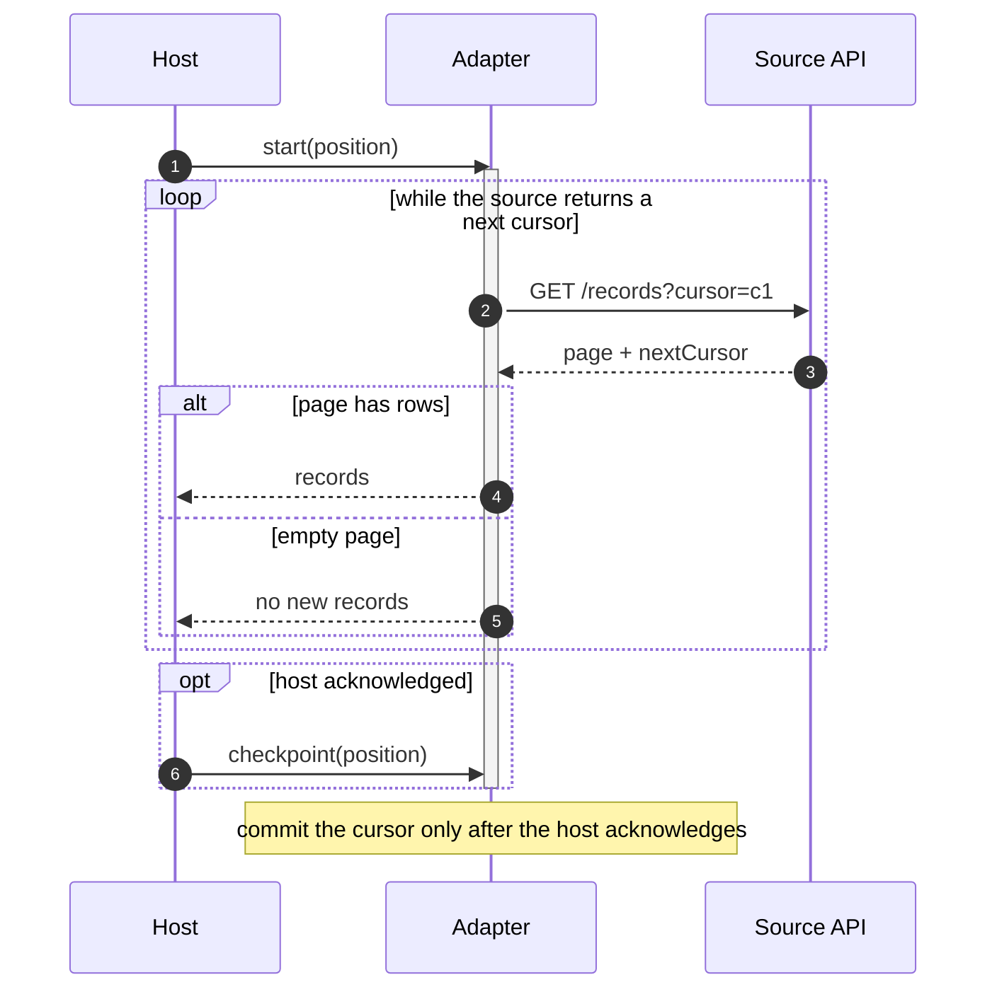
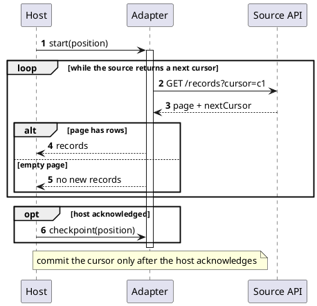

# Sequence diagram

**Flow:** $ARGUMENTS

Draw who calls whom, in what order, for one flow, traced from the real code. If no flow is given, list the main entry points you can find (public methods called from outside the module, request handlers, lifecycle callbacks) and ask which one to trace.

## 1. Trace the call path

1. **Find the entry point.** If the named method or flow can't be found, say so and list near matches. Never draw from imagination.
2. **Read every method on the path,** in order. Note the participants (real class names), the calls (real method names), the return values, and every branch, loop, retry, async hand-off and queue hop.
3. **Mark what you can't establish.** If a hop goes through reflection, dynamic dispatch or code that isn't available, mark it uncertain rather than guessing the order.
4. **Keep it readable.** About 6 to 8 participants is the limit. Collapse internal helpers into their owning class, and split a long flow into an overview plus detail diagrams.

## 2. Draw it

- Participants are named after the real classes or systems, and messages after the real method calls or requests.
- Use `autonumber`, activation bars for the main callee, `loop` for paging or retries, `alt`/`else` for branches, and `opt` for optional steps.
- Show return values where they matter, and add a note for any invariant the flow relies on.

Both templates were checked: the Mermaid one parses with Mermaid 11, and the PlantUML one passes `plantuml -checkonly`. Replace the example names with real ones.

**Mermaid**

**PlantUML**

## 3. Save and check

- Save both versions where the repo keeps diagrams, or under `docs/diagrams/` if there's no such place (`.mmd` or `.md` for Mermaid, `.puml` for PlantUML).
- Parse or render them: `plantuml -checkonly file.puml`, then `plantuml -tsvg file.puml` (sequence diagrams don't need Graphviz); for Mermaid, `mmdc -i file.mmd -o file.svg` if mermaid-cli is installed, or a Markdown preview. If nothing is available, say the diagram is unrendered.
- Walk through the code once more and check every call in the diagram happens, in that order.

## Avoid these errors

- In Mermaid, a semicolon in a message breaks parsing; reword it, or write it as `#59;`. `end` closes a block, so a participant named `end` breaks parsing too.
- PlantUML doesn't report a missing `end`: an unclosed `alt`, `loop` or `opt` silently swallows the messages after it. Close each block where the code's branch or loop ends, and pair every `activate` with a `deactivate`.
- Name participants exactly as in the code, and keep one flow per diagram.
