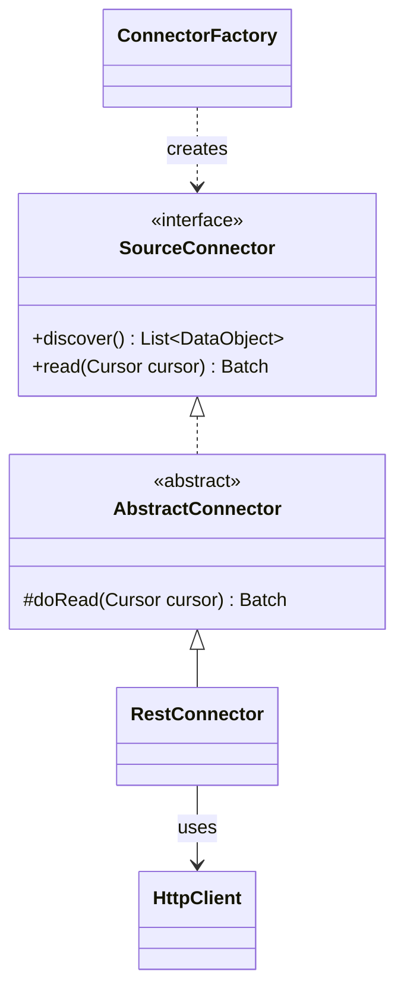
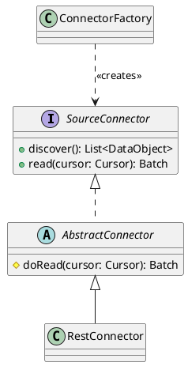
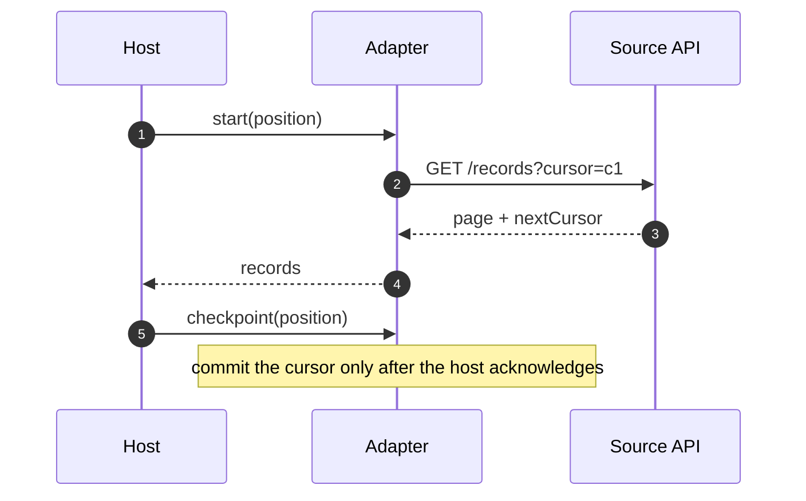
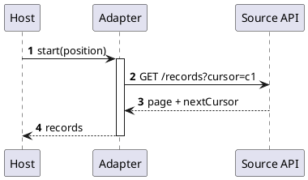
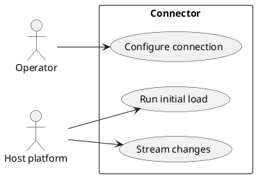
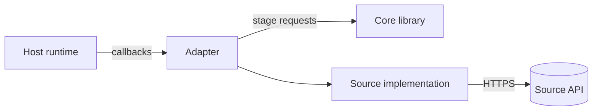
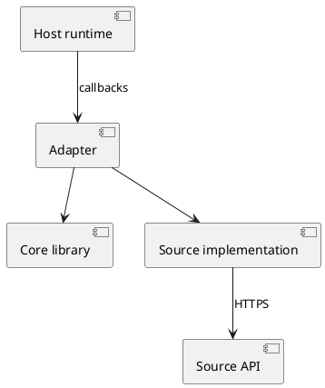
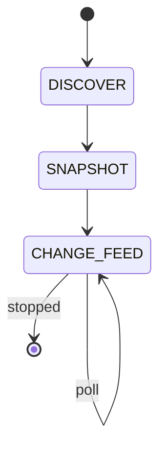
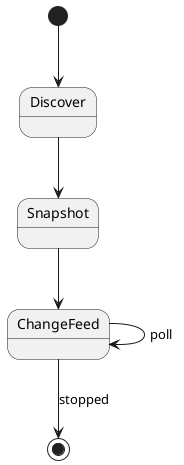

# UML diagram

**Target:** $ARGUMENTS

The target names what to draw, optionally followed by the diagram type. With no type, pick the one that answers the question (step 2). With no target at all, list two or three useful candidates from the repo (main packages, main flows) and ask which one to draw.

For a single type with more detail, the `class-diagram`, `sequence-diagram`, `usecase-diagram` and `c4` commands go deeper.

## 1. Preflight

1. **Check the source exists.** Find and read the code first. If the named class, package or flow can't be found, say so and list what was found. Never draw from imagination.
2. **Check the type fits the question.** "What happens when X is called" is a sequence diagram, not a class diagram. If the requested type doesn't fit, say so and propose the right one.
3. **Check the scope is readable.** A class diagram of 20 or more types is unreadable; propose one diagram per package or concern.
4. **Check the flow is traceable.** If a hop can't be established from the code (reflection, dynamic dispatch, missing sources), mark it uncertain rather than guessing the order.
5. **Check the tooling.** Mermaid renders in most Markdown viewers. PlantUML needs Java, and Graphviz (`dot`) for most types; sequence diagrams don't need Graphviz, and `!pragma layout smetana` avoids it for the others. Don't say a diagram rendered unless you rendered or parsed it.

## 2. Pick the type

| Question | Type |
|---|---|
| What are the parts, and how do they relate? | class, or component for coarser parts |
| Who calls whom, in what order? | sequence |
| What can each kind of user do? | use case |
| What states does one object go through? | state |
| How do the deployable pieces fit together? | component, or the `c4` command |

## 3. Extract the model from the source

- **Class:** types, fields, methods, `extends`, `implements` and associations, read from the code. Count them, so you can check nothing is missed.
- **Sequence:** the actual call flow of the scenario, read method by method. Note return values, async hand-offs and loops.
- **Use case:** actors (human roles and external systems) and their goals, from the public API, endpoints or requirements.
- **State:** the states and transitions, from the enum or state field and the code that changes it.

Use names exactly as they appear in the code, with one concern per diagram.

## 4. Templates

Every template parsed cleanly with Mermaid 11, and the PlantUML ones passed `plantuml -checkonly`. Replace the example names with real ones.

**Class (Mermaid)**

**Class (PlantUML, full members)**

**Sequence (Mermaid)**

**Sequence (PlantUML)**

**Use case (PlantUML)**

**Component (Mermaid flowchart)**

**Component (PlantUML)**

**State (Mermaid)**

**State (PlantUML)**

## 5. Save and check

- Give both Mermaid and PlantUML unless the user asked for one. Save them where the repo keeps diagrams, or under `docs/diagrams/` if there's no such place (`.mmd` or `.md` for Mermaid, `.puml` for PlantUML).
- Parse or render each one: `plantuml -checkonly file.puml`, then `plantuml -tsvg file.puml`; for Mermaid, `mmdc -i file.mmd -o file.svg` if mermaid-cli is installed, or a Markdown preview. If nothing is available, say the diagram is unrendered.
- Check the element and edge counts against the model you extracted.

## Avoid these errors

**Mermaid**
- `end` as a node name breaks a flowchart. Rename the node (`done`, `stop`) or quote its label.
- Brackets or parentheses inside a label break parsing unless the label is quoted: `a["read(cursor)"]`, not `a[read(cursor)]`.
- Write generics in class diagrams as `List~Row~`, Mermaid's own syntax.
- Stereotypes go inside the class body (`<<interface>>`), or on their own line.

**PlantUML**
- One member per line. A one-line body such as `interface Foo { +bar(): int }` fails to parse.
- Wrap every diagram in `@startuml` and `@enduml`.
- If `dot` isn't installed, add `!pragma layout smetana`, or use a sequence diagram, which doesn't need it.

**Both**
- Element and edge names must match the code exactly. Keep one concern per diagram.
