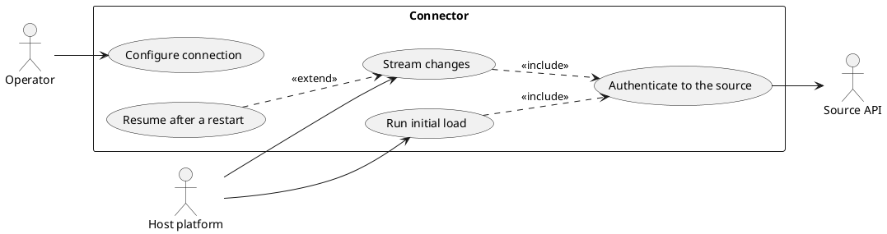
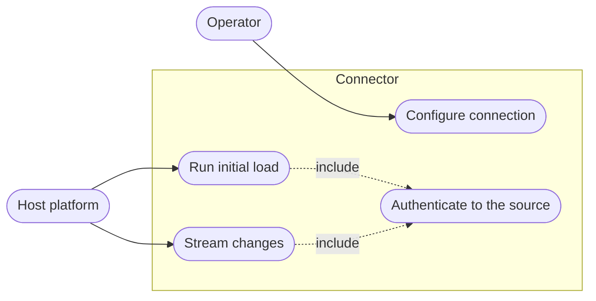

# Use-case diagram

**Scope:** $ARGUMENTS

Show who uses the system and what they can achieve with it. If no scope is given, use the system in the current repository. If the scope is a requirements text, work from that text.

## 1. Find the actors and goals

1. **Read the sources of truth:** the public API, endpoints, command-line entry points and lifecycle callbacks in the code, plus the README, or the requirements text if one was given. If none of these exist, say so and ask for the requirements. Never invent actors.
2. **Actors** are human roles (operator, administrator, analyst) and external systems that drive the system (a host platform, a scheduler). A system the code only calls out to (the source API) is a secondary actor; put it on the right.
3. **Use cases are user-meaningful goals** ("Run initial load", "Rotate credentials"), not UI clicks or method names.
4. **Relationships:** use `include` for a step that every run of the base case performs (authentication, say), and `extend` for an optional or conditional variant (resuming after a restart). Use them sparingly.

## 2. Draw it

Both templates were checked: the PlantUML one passes `plantuml -checkonly`, and the Mermaid alternative parses with Mermaid 11. Replace the example names with real ones.

**PlantUML (true UML use-case notation)**

**Mermaid alternative** (Mermaid has no use-case diagram, so this is a flowchart in the same shape; use it where only Mermaid renders)

## 3. Save and check

- Save the diagram where the repo keeps diagrams, or under `docs/diagrams/` if there's no such place (`.puml` for PlantUML, `.mmd` or `.md` for Mermaid).
- Parse or render it: `plantuml -checkonly file.puml`, then `plantuml -tsvg file.puml` (use-case diagrams need Graphviz; without it, add `!pragma layout smetana`); for Mermaid, `mmdc -i file.mmd -o file.svg` if mermaid-cli is installed, or a Markdown preview. If nothing is available, say the diagram is unrendered.
- Check that every use case traces back to something real in the code or requirements, and that every actor has at least one use case.

## Avoid these errors

- In PlantUML, the `<<include>>` and `<<extend>>` arrows are dashed (`..>`) and point from the base case to the included case, and from the extension to the base case.
- In Mermaid, quote labels that contain brackets or parentheses, and never name a node `end`.
- Keep the diagram to one system boundary and at most about 12 use cases; split by feature beyond that.
